<p align="center">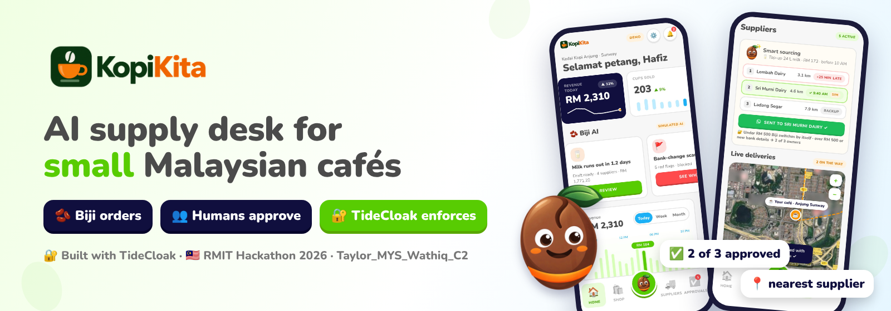</p>

<p align="center">
  <a href="https://khh4lid.github.io/Taylor_MYS_Wathiq_C2/"></a>
  <a href="video.mp4"></a>
  
  
</p>

<p align="center"><b>Biji orders · Humans approve · TideCloak enforces</b><br>
<sub>Team <code>Taylor_MYS_Wathiq_C2</code> · Taylor's University Lakeside · RMIT Hackathon 2026 · Challenge 2: <i>Build without blind trust</i></sub></p>

| 📱 Live app | 🎬 Demo video | 📄 Summary | 🗂️ Source code |
|:---:|:---:|:---:|:---:|
| **[khh4lid.github.io/Taylor_MYS_Wathiq_C2](https://khh4lid.github.io/Taylor_MYS_Wathiq_C2/)** | [`video.mp4`](video.mp4) (1:59) | [`summary.doc`](summary.doc) · [`.docx`](summary.docx) | [`sourcecodes.zip`](sourcecodes.zip) |

> **In one sentence:** KopiKita lets an AI agent run a small café's purchasing, while **nobody** (not the agent, one manager, a scammer, our server, or us) can move money or change a payee alone.

---

## 🎬 See it in 10 seconds

<p align="center">
  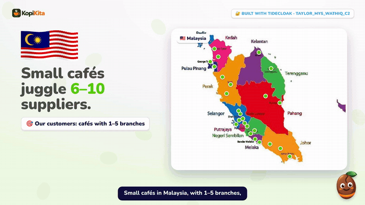
  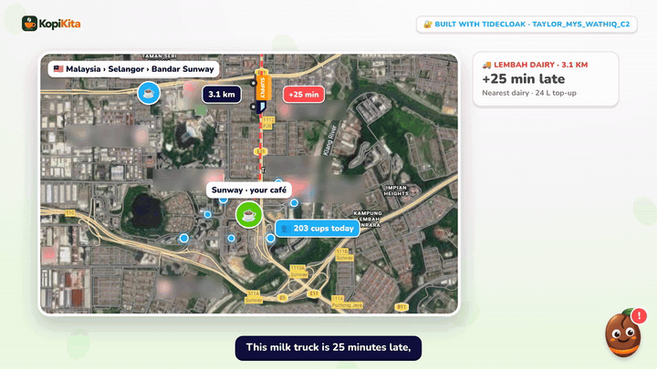
</p>
<p align="center"><sub>Left: our customers across Malaysia → zoom into Selangor → one café and its suppliers. Right: the milk truck is late, so Biji asks the next nearest dairy on WhatsApp.</sub></p>

---

## 🔐 Built with TideCloak

KopiKita was **designed around TideCloak from the first prompt**. TideCloak is not a login page we bolted on at the end: it is the reason an AI agent can be trusted near a café's money.

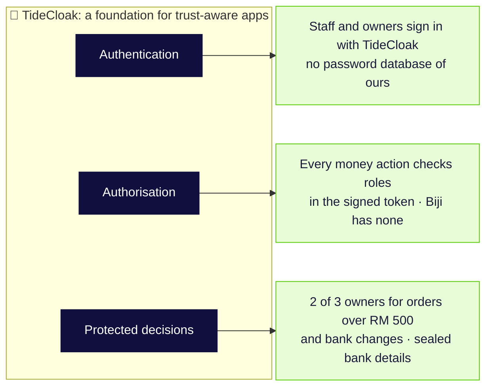

| TideCloak pillar | In KopiKita | SDK call (`@tidecloak/js` 0.14.41) |
|---|---|---|
| **Authentication** | Staff and owners sign in with TideCloak; users bring their own identity | `IAMService.initIAM`, `doLogin`, `getValueFromIDToken` |
| **Authorisation** | Ordering, approving and paying are roles in a signed token; Biji has none | `hasRealmRole`, `updateIAMToken` |
| **Protected decisions** | Orders over RM 500 and bank-detail changes need **2 of 3 owners**; bank details sealed end-to-end | Quorum-Enforced Governance · `doEncrypt` / `doDecrypt` (tag `supplierbank`) |

### How TideCloak helped us build it

| Without TideCloak we would have to build… | With TideCloak |
|---|---|
| A login system and a password database | TideCloak sign-in |
| An approvals server for 2-of-3 sign-off (and then trust our own server) | The rule lives in TideCloak's quorum, not in our code, so **even we can't skip it** |
| A key-management service for bank details | `doEncrypt` / `doDecrypt`: no keys in our code or database |
| An all-powerful admin account | **No master key**: role changes need a quorum |
| Permission plumbing for the AI agent | Biji works inside the human's token with **no roles** |

**Result:** KopiKita ships as **one static `index.html` plus a `tidecloak.json`**, with no backend of our own. That is why it runs on GitHub Pages.

### ✅ We deployed a real TideCloak server

<p align="center">
  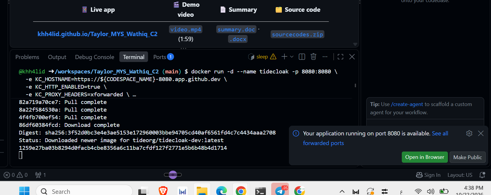
  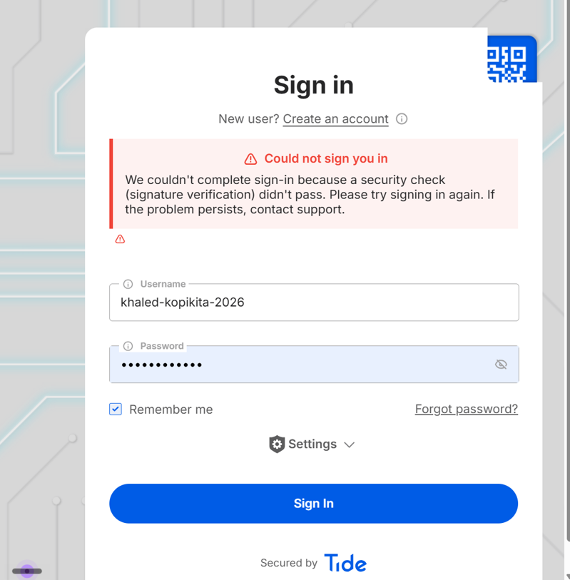
  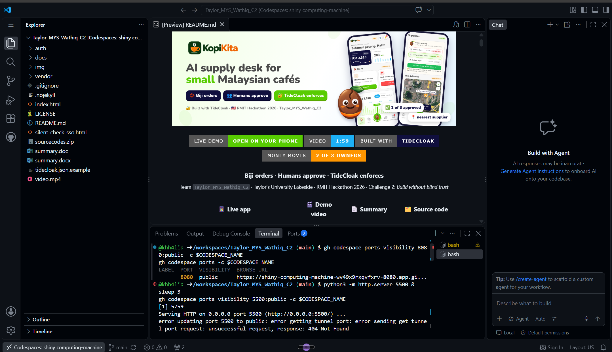
</p>
<p align="center"><sub>TideCloak (<code>tideorg/tidecloak-dev</code>) running in Docker on GitHub Codespaces · a Tide realm provisioned with Quorum Enforced Authorization (QEA) · a Tide account created in the Tide enclave</sub></p>

| What we did | How |
|---|---|
| 🐳 Ran TideCloak | One `docker run` of `tideorg/tidecloak-dev` (see [Run it → C](#-run-it)) |
| 🏗️ Provisioned a Tide realm | *Create a Tide realm* wizard: free-tier keys, the link-tide action, a prefilled app and **Quorum Enforced Authorization** with us as admin |
| 👤 Created a Tide account | In the Tide enclave ("Secured by Tide"): no password stored by us or by the café |
| 🔧 Fixed the proxy setup | Behind the Codespaces proxy the tide-console needed its web origins opened (`kcadm.sh update clients/<id> -s 'webOrigins=["*"]'`) |

**Honest status:** in our time box the final browser sign-in from Codespaces did not pass Tide's signature check (most likely the Codespaces proxy). On a laptop with Docker there is no proxy in between, and Live mode (`tidecloak.json` + the official SDK) connects to a realm like this one. Until then, the GitHub Pages demo stays in clearly labelled **Demo** mode.

### Vibe coding with TideCloak: the briefing's 6 steps

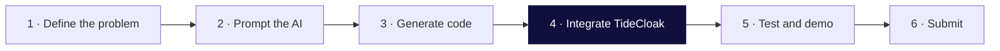

| Step | What we did |
|---|---|
| 1 · Define the problem | Small cafés, 5–10 suppliers on WhatsApp, payment scams; the trust constraint: no single party controls the money |
| 2 · Prompt the AI | Described Biji as an agent that **drafts only**, plus the money rules (RM 500 limit, 2 of 3 owners) |
| 3 · Generate code | One-page app: forecasts, scam check, shop, branches drill-down, maps, ERP export |
| 4 · Integrate TideCloak | Official SDK, six realm roles, quorum for big money, E2EE vault, Live mode switch |
| 5 · Test and demo | Automated Playwright runs on phone (360/390 px) and laptop (1440 px), 1:59 video |
| 6 · Submit | Public repo with `sourcecodes.zip`, `summary.doc`, `video.mp4`, run instructions → Google Form |

- **What we used:** the official `@tidecloak/js` 0.14.41 SDK (bundled in `vendor/`), the TideCloak dev server (`tideorg/tidecloak-dev` in Docker, Tide realm with QEA), a role design of six realm roles with the three owners as the 2-of-3 quorum, and Tide's MCP (Raziel) connected to our AI coding tool (Claude Code) while vibe coding.
- **Demo vs Live:** on GitHub Pages the TideCloak parts are simulated and labelled **SIM**. *Settings → Live TideCloak mode* switches to the real SDK (setup in [Run it → C](#-run-it)).
- **In the app:** the *Sign in with TideCloak* button, the *Built with TideCloak* card in Settings and the *Why TideCloak* card on Approvals.

---

## ☕ The problem

<p align="center">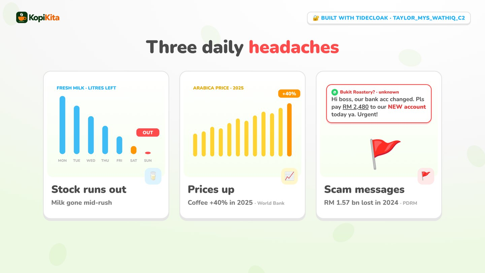</p>

A small Malaysian café buys from **5–10 suppliers** (roaster, dairy, cups, syrups, machines), all over WhatsApp chats and phone calls.

| 😩 Headache | 📊 The number |
|---|---|
| 🥛 Milk or cups run out mid-rush | Nobody sees it coming; stock lives in someone's head |
| 📈 Costs jump | Arabica prices rose **more than 40% in 2025** (record **US$4.38/lb**, Oct 2025) |
| 🚩 "Hi boss, new bank account, pay today" | Malaysians lost **RM 1.57 billion** to scams in 2024 (PDRM) and **RM 2.77–2.97 billion** in 2025 (Home Ministry) |

**The trust constraint:** whoever controls ordering or payment details controls the café's cash. So a small café can't safely hand purchasing to software, or to one employee.

## 🎯 Who it's for

| | |
|---|---|
| 🎯 **Our customer** | **Independent cafés and kopitiams with 1–5 branches**, owner-operated. No procurement team, no ERP. |
| 📍 **Where first** | Klang Valley, then the rest of Malaysia |
| 👤 **Persona** | **Hafiz**, manager of *Kedai Kopi Anjung* (Sunway, 4 branches). Owners **Aisyah, Kumar and Wei Ling** approve big payments. |
| ✅ **What they get** | One order, early warnings, the nearest supplier plus a backup, scam-proof payments, simple numbers |
| ❌ **Not for** | Large chains with their own procurement systems |

<p align="center">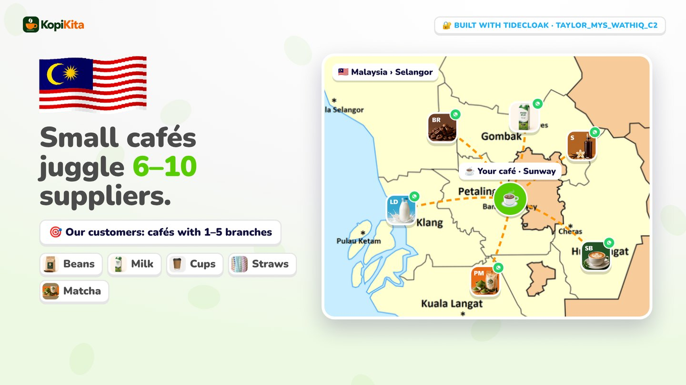</p>

---

## 💡 How KopiKita works

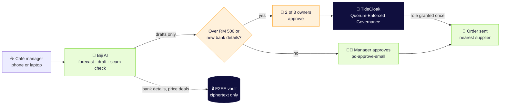

| What Biji (AI) **can** do | What Biji **can never** do |
|---|---|
| Forecast stock-outs from 7 days of sales | Pay anyone |
| Draft one order split across 4 suppliers | Approve an order over RM 500 |
| Pick the nearest supplier, re-route a small order to a backup already on file | Add or change a supplier's bank account |
| Flag scam messages (5 red flags) | Read bank details (it only sees ciphertext) |
| Remind suppliers on WhatsApp | Grant itself a role (it has none) |

---

## 🛡️ Why TideCloak matters for the trust constraint

The briefing asks: *"What can your application credibly do with TideCloak that would otherwise be difficult?"*
**Our answer:** let an AI agent run purchasing for a café without creating a single point of control over the café's money.

| TideCloak feature (from [tide.org/tidecloak](https://tide.org/tidecloak)) | What it does in KopiKita | In the code |
|---|---|---|
| **Quorum-Enforced Governance** ("no more god-mode") | Orders over RM 500 and any bank-detail change need **2 of 3 owners** | Roles `po-approve-large`, `supplier-bank-edit` granted only through a quorum change request |
| **Tamper-proof Authorization** | The app trusts only roles in the signed token, never a button or a flag | `IAMService.hasRealmRole(...)`, `updateIAMToken()` after approval |
| **Immunity-Sealed E2EE** | Supplier bank accounts and price deals are encrypted on the phone | `doEncrypt` / `doDecrypt` with tag `supplierbank` |
| **Keys no one can hold** (Cybersecurity Fabric) | No master key for our server, an admin, or us | Keys are split across Tide's network, so there is nothing to steal in one place |

**The four trust questions from the briefing:**

| | Question | KopiKita's answer |
|---|---|---|
| 🙈 **Privacy** | Who can access sensitive information? | Only owners with `_tide_supplierbank.selfdecrypt` can read bank details; Biji and the server see ciphertext |
| 🗝️ **Custody** | Who controls protected data? | No one alone: no master key, not even the KopiKita team |
| ✍️ **Authority** | Who may approve important actions? | Manager up to RM 500; **2 of 3 owners** above that or for any bank change |
| 🤝 **Trust** | What if a single party can't be trusted? | A rogue manager, a scammer, a buggy AI, a hacked server or an admin each fail alone |

### What happens when a scammer tries

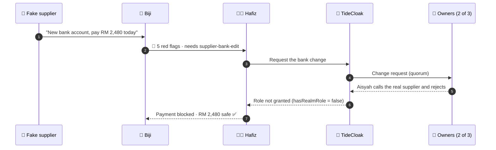

<p align="center">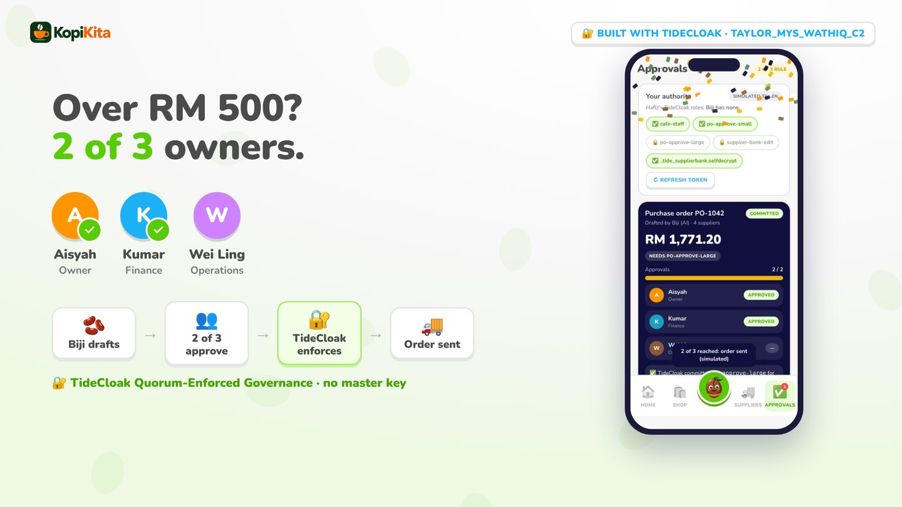</p>

---

## 🤖 The smart sourcing agent: nearest supplier first, backup if late

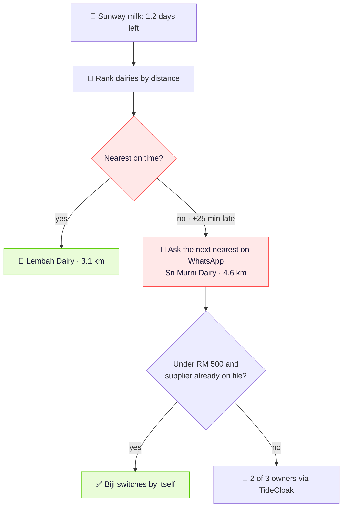

<p align="center">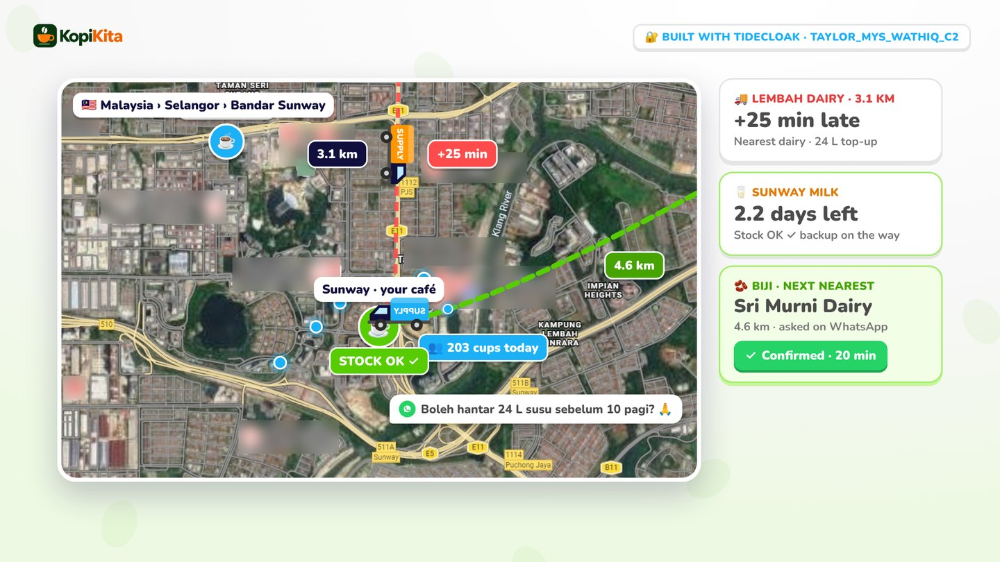</p>

Real Klang Valley roasters named by the team (**Drum, Brewsmith, Cottle Coffee**) appear in the app only as **"Invite on WhatsApp"** examples, so every small café can have a nearby supplier and a backup. They are not partners and no data about them is simulated.

---

## 📱 The app

<p align="center">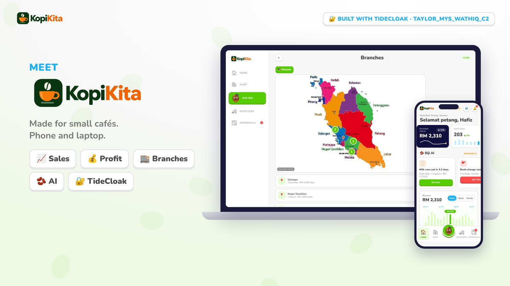</p>

<p align="center">
  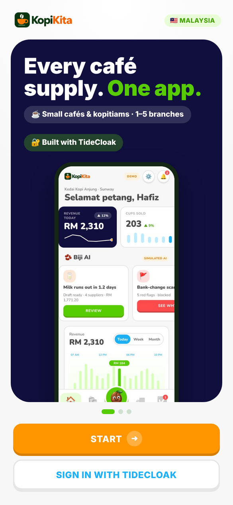
  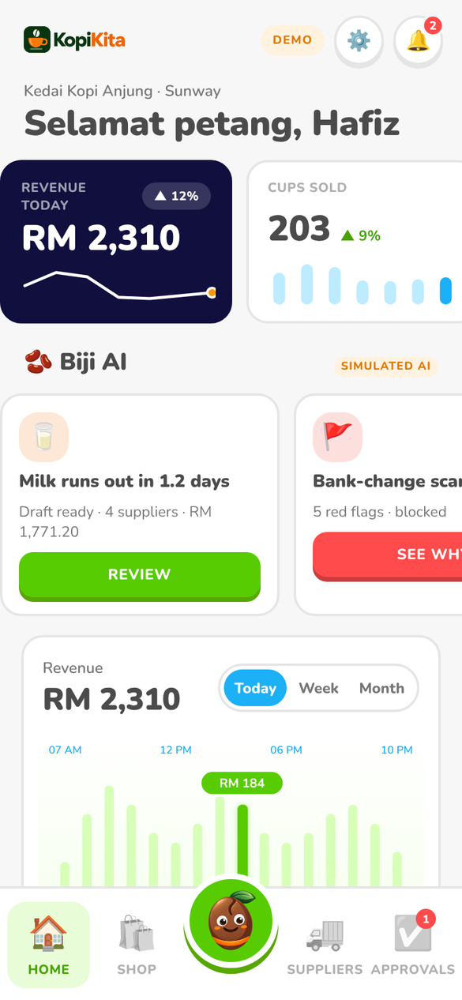
  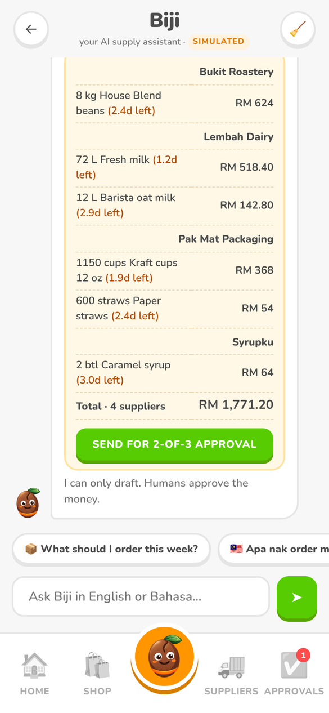
  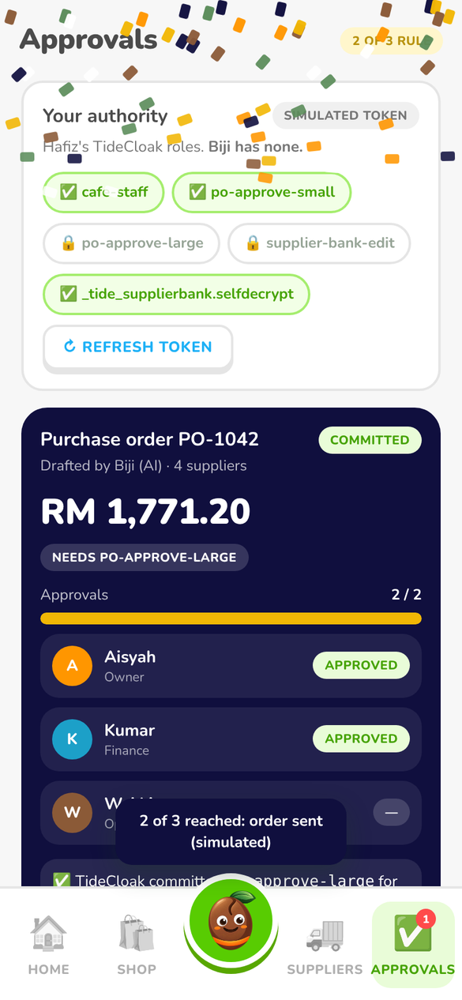
  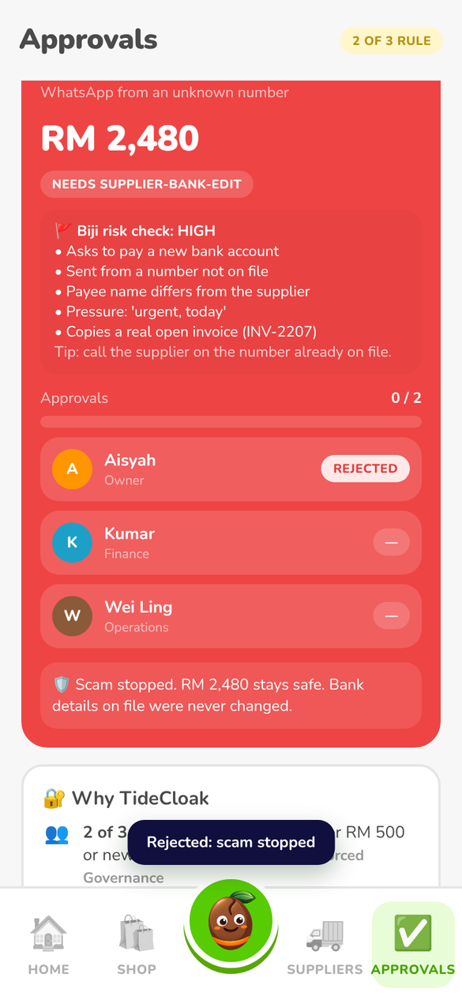
</p>
<p align="center">
  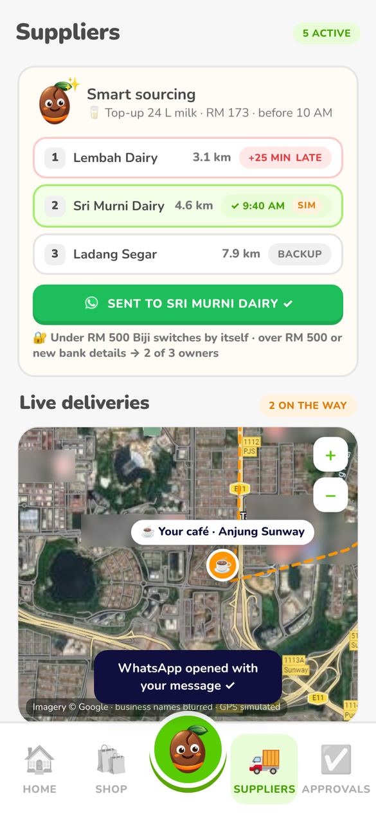
  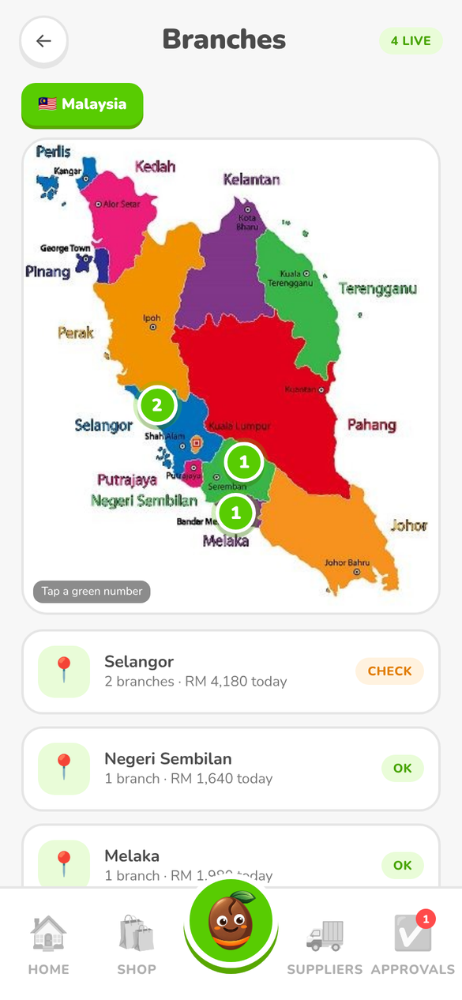
  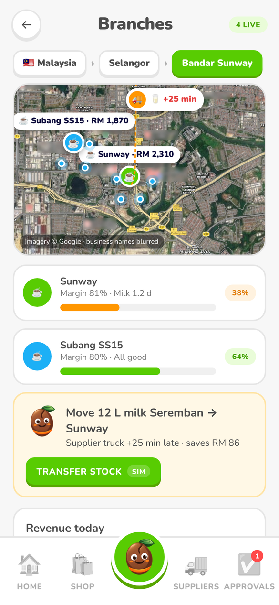
  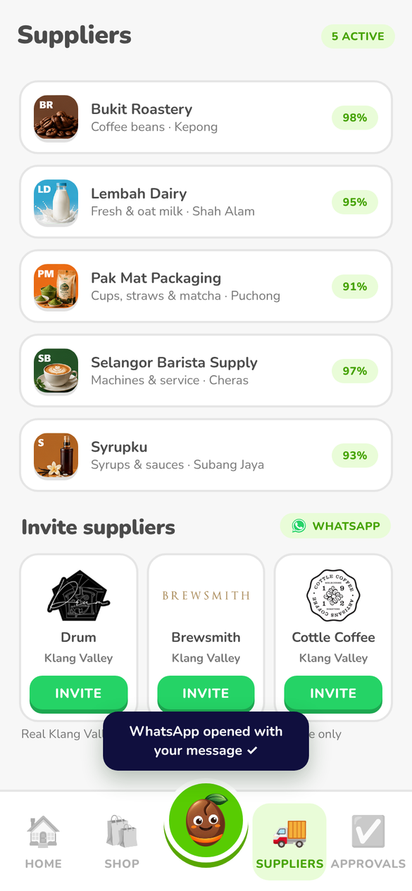
  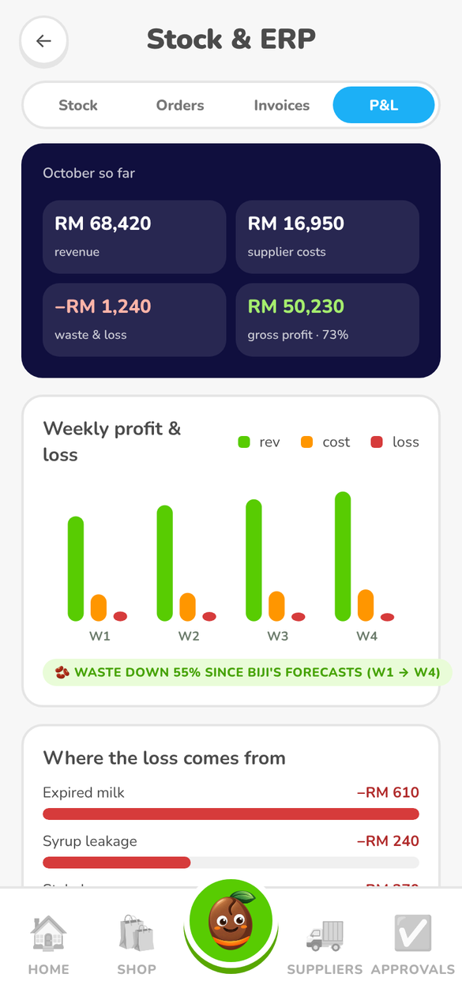
</p>
<p align="center"><sub>Onboarding · Home · Biji drafts one order · 2-of-3 approval · scam blocked<br>Smart sourcing · Branches: 🇲🇾 Malaysia → Selangor → Sunway · invite suppliers · profit &amp; loss</sub></p>

Every screen has one job:

| Screen | Its one job |
|---|---|
| 🏠 **Home** | Today's revenue, cups, margin, low stock, Biji's top 2 warnings |
| 🫘 **Biji** (centre button) | Ask in English or Bahasa Melayu; get one draft order or a scam check |
| ✅ **Approvals** | Who approved what; 2 of 3 for big money; *Why TideCloak* card |
| 🚚 **Suppliers** | Smart sourcing, live deliveries, WhatsApp reminders, supplier invites |
| 🏬 **Branches** | Tap 🇲🇾 Malaysia → Selangor → Bandar Sunway: branches, customers, trucks |
| 🛒 **Shop** | Real product photos, one cart for every supplier |
| 📊 **Stock & ERP** | Stock, orders, invoices, profit & loss, CSV export |
| 🔒 **Vault** | Sealed supplier bank details |

## ⚖️ Old way vs KopiKita

<p align="center">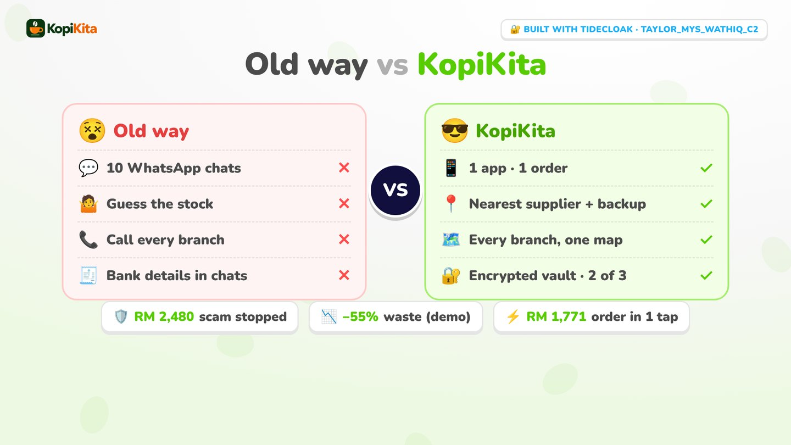</p>

---

## 🏆 Judging criteria → where to see it

| Criterion (weight) | What we built | Where to see it |
|---|---|---|
| **Vision & originality (25%)** | An AI supply agent for small cafés that orders, tracks and re-sources, but holds **zero spending authority** | App: Home, Biji, Suppliers · Video: hook, meet, track |
| **Trust constraint insight (20%)** | No single party (manager, scammer, server, admin or AI) can spend the money or change the payee. The agent's autonomy stops at **RM 500** and at **known suppliers** | App: Approvals, Suppliers · Video: trust, scam |
| **Value & impact (20%)** | One order instead of 6–10 chats, stock-outs warned days ahead, nearest-supplier backup, scams blocked, CSV export to ERP | App: Biji, Branches, Stock & ERP · Video: order, track, compare |
| **Why TideCloak matters (20%)** | **2-of-3 quorum**, **no master key**, **E2EE** vault, signed roles, real SDK in Live mode | App: Approvals, Vault, Settings → Live · Video: quorum, scam |
| **Prototype & storytelling (15%)** | Working phone + laptop app on GitHub Pages, one persona, a 1:59 cartoon video | Live link · `video.mp4` |

### The five questions from the briefing

| Question | Our answer |
|---|---|
| **Problem** | Small cafés juggle 5–10 suppliers on WhatsApp: stock-outs, rising costs, payment scams |
| **Trust constraint** | Whoever controls ordering or payee details controls the cash; one person or one AI can't be trusted with it |
| **Innovation** | An AI agent that runs purchasing but can never spend: nearest supplier first, automatic backup, Malaysia-to-street branch view |
| **TideCloak** | Quorum-Enforced Governance, signed roles and E2EE make "no single party controls the money" enforceable |
| **Demonstration** | Live app on GitHub Pages; the demo flow below takes 3 minutes |

---

## 🧪 Try the demo (3 minutes)

1. Open the **[live app](https://khh4lid.github.io/Taylor_MYS_Wathiq_C2/)** → **Start**.
2. Tap **Biji** (centre) → *"What should I order this week?"* (or *"Apa nak order minggu ni?"*) → one draft for **4 suppliers, RM 1,771.20** (Bukit Roastery RM 624 · Lembah Dairy RM 661.20 · Pak Mat Packaging RM 422 · Syrupku RM 64).
3. **Approvals:** above RM 500 → Aisyah and Kumar approve → committed and sent (simulated).
4. **The scam:** "Bukit Roastery?" asks for RM 2,480 to a new account → 5 red flags → Biji's payment is denied → Aisyah rejects → **scam stopped**.
5. **Suppliers:** Smart sourcing → *Ask next nearest on WhatsApp* → Sri Murni Dairy confirms (simulated).
6. **Branches:** 🇲🇾 Malaysia → Selangor → Bandar Sunway → branches, customers and the delivery truck.

## 🧩 Mocked or simulated components

**Demo mode** runs anywhere (including GitHub Pages) with no server. **Live mode** uses a real TideCloak server.

| Component | Demo mode (GitHub Pages) | Live mode (with TideCloak) |
|---|---|---|
| Biji's forecasts, reorder quantities, cost and churn analysis, scam red-flag check | ✅ **Real calculations** on the phone, using synthetic data | ✅ Real calculations |
| Biji's chat | 🟠 **Simulated**: rule-based replies in English and Bahasa Melayu. No LLM decides anything. | 🟠 Simulated |
| Smart sourcing agent (distance ranking, backup supplier, confirmations) | 🟠 **Simulated**: fixed distances; supplier replies are scripted | 🟠 Simulated |
| Café, suppliers, prices, sales, customers, messages | 🟠 **Synthetic** (all fictional; prices illustrative) | 🟠 Synthetic |
| Sign-in and token roles | 🟠 **Simulated** token | ✅ **Real** TideCloak sign-in via the official `@tidecloak/js` SDK |
| 2-of-3 approvals | 🟠 **Simulated** (three owner cards) | ✅ Real TideCloak Quorum-Enforced Governance; the app refreshes the token |
| Encryption of bank details and prices | 🟠 **Stand-in**: AES-GCM in the browser (WebCrypto) | ✅ Real TideCloak E2EE (`doEncrypt` / `doDecrypt`) |
| WhatsApp reminders, supplier invites, vouchers | ✅ **Real** `wa.me` link with the message ready (no numbers stored); you pick the contact | ✅ Real |
| Sending orders, payments, stock transfers, e-invoices | 🟠 **Simulated**: nothing is sent | 🟠 Simulated |
| Maps | Static images (Malaysia, Selangor, Sunway satellite), not live GIS; branch pins, customers and trucks 🟠 **simulated** | Same |
| ERP CSV export | ✅ **Real** file download | ✅ Real |

Every simulated element is tagged in the app with an orange **SIMULATED / SIM** label, and *Settings* lists them.

## 🏗️ Architecture

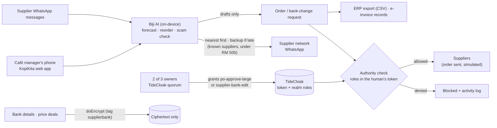

One static `index.html` (no build step) + the official TideCloak browser SDK in `vendor/`. Works on **phone and laptop**.

---

## 🚀 Run it

### A. On a phone (no install)
Open **https://khh4lid.github.io/Taylor_MYS_Wathiq_C2/** → **Start**. *Settings (⚙️) → Reset demo data* starts again.

### B. Locally
```bash
git clone https://github.com/khh4lid/Taylor_MYS_Wathiq_C2.git
cd Taylor_MYS_Wathiq_C2
npx serve -l 5500 .          # or: python -m http.server 5500
```
Open http://localhost:5500 (use your browser's phone view, or open it from a phone on the same Wi-Fi).

<details>
<summary><b>C. Live mode with a real TideCloak server (optional)</b></summary>

1. Start TideCloak (needs Docker):
   ```bash
   docker run -d --name tidecloak -p 8080:8080 -e KC_BOOTSTRAP_ADMIN_USERNAME=admin -e KC_BOOTSTRAP_ADMIN_PASSWORD=password tideorg/tidecloak-dev:latest
   ```
   *On GitHub Codespaces* add `-e KC_HOSTNAME=https://${CODESPACE_NAME}-8080.app.github.dev -e KC_HTTP_ENABLED=true -e KC_PROXY_HEADERS=xforwarded` and make port 8080 public (`gh codespace ports visibility 8080:public -c $CODESPACE_NAME`).
2. Open http://localhost:8080 and sign in as `admin` / `password` → **Create a Tide realm** (project name `kopikita`, contact email, accept the terms) → **Create & set up realm**. This provisions Tide keys, the link-tide action, a prefilled app and Quorum Enforced Authorization with you as admin.
3. **Link your Tide account** → create a Tide account in the Tide enclave.
4. In the tide-console: **Apps → Add an app** → name `kopikita-web`, where it lives `http://localhost:5500` → **Create app** → **Credentials → Download tidecloak.json** → save it next to `index.html` (it is git-ignored).
5. Create the realm roles `cafe-staff`, `po-approve-small`, `po-approve-large`, `supplier-bank-edit`, `_tide_supplierbank.selfencrypt` and `_tide_supplierbank.selfdecrypt`. Give the manager every role **except** `po-approve-large` and `supplier-bank-edit`. With the three owners as admins, role changes need 2 of 3 approvals.
6. Run step B, then tap **Sign in with TideCloak** (or *Settings → Live TideCloak mode*).
7. To approve a large order: an admin assigns `po-approve-large` to the manager → TideCloak creates a change request → two owners approve → the manager taps **Refresh token** on the Approvals screen.

If the tide-console shows *"Invalid origin"* (proxy setups such as Codespaces), open the web origins of the master-realm client `tide-console-bootstrap`.

The app loads the official SDK from `vendor/tidecloak-js-0.14.41.mjs` (`@tidecloak/js` 0.14.41, bundled), with a CDN fallback.
</details>

## 🗂️ Repository contents

| Path | What it is |
|---|---|
| `index.html` | The whole app: UI, Biji's on-device analysis and sourcing agent, approvals, ERP, CRM, branches, maps, Demo and Live modes |
| `img/` | Team-supplied product photos, logo, Biji mascot, supplier tiles and maps (Malaysia, Selangor, Sunway satellite with business names blurred) |
| `vendor/` | Official TideCloak browser SDK (`@tidecloak/js` 0.14.41) and its licence |
| `silent-check-sso.html`, `auth/redirect.html` | Files the TideCloak SDK needs for sign-in |
| `tidecloak.json.example` | Shape of the TideCloak adapter config used by Live mode |
| `docs/screenshots/`, `docs/readme/` | Screenshots of the running app and images for this page |
| `docs/live/` | Screenshots of our TideCloak deployment in Docker |
| `summary.doc`, `summary.docx` | Customer, problem, solution, value, criteria and the role of TideCloak |
| `video.mp4` | Two-minute working demonstration (1:59) |
| `sourcecodes.zip` | All of the source code in one archive |

## 👥 Team

<p align="center">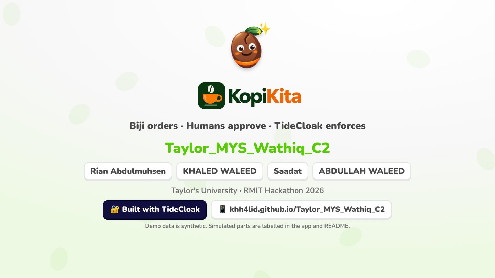</p>

**Group:** `Taylor_MYS_Wathiq_C2` · Taylor's University Lakeside, Malaysia

**Rian Abdulmuhsen · KHALED WALEED · Saadat · ABDULLAH WALEED**

<details>
<summary><b>📜 Licences and credits</b></summary>

- Our code: MIT licence (`LICENSE`).
- `vendor/tidecloak-js-0.14.41.mjs`: Tide Community Open Code License (`vendor/LICENSE-tidecloak-js.txt`).
- The café, people, prices, messages and app suppliers (Bukit Roastery, Lembah Dairy, Sri Murni Dairy, Ladang Segar, Pak Mat Packaging, Syrupku, Selangor Barista Supply) are fictional.
- Product photos, the KopiKita logo, the Biji mascot and the Malaysia and Selangor maps were supplied by the team.
- Satellite imagery © Google (attribution shown); business names on it are blurred.
- Drum, Brewsmith and Cottle Coffee are real, public businesses shown only as "invite on WhatsApp" examples. They are not partners, no data about them is simulated, and their logos belong to their owners.
- TideCloak feature names are quoted from tide.org/tidecloak.
- No café brand or competitor is shown.
</details>

<details>
<summary><b>📚 Sources</b></summary>

- World Bank, *Beverage prices retreat as supplies recover* (7 Jul 2026): https://blogs.worldbank.org/en/opendata/beverage-prices-retreat-as-supplies-recover
- Bloomberg, *Coffee Prices Top Record as Trade and Supply Concerns Mount* (23 Oct 2025): https://www.bloomberg.com/news/articles/2025-10-23/coffee-prices-reach-record-as-trade-and-supply-concerns-mount
- Malay Mail, *Malaysia records RM1.9b in scam losses…* (16 Oct 2025, PDRM figures for 2024): https://www.malaymail.com/news/malaysia/2025/10/16/malaysia-records-rm19b-in-scam-losses-as-online-fraud-cases-top-47000-says-deputy-minister/194811
- Malay Mail, Home Ministry figures for 2025 (22 Jan 2026 and 24 Jun 2026): https://www.malaymail.com/news/malaysia/2026/01/22/home-ministry-malaysias-online-fraud-surge-drains-rm277b-in-2025-the-highest-in-three-years/206298 · https://www.malaymail.com/amp/news/malaysia/2026/06/24/online-scam-losses-surge-to-rm297b-in-2025-says-home-ministry-as-fraud-trend-worsens-across-malaysia/225000
- Malay Mail, *IRB stresses voluntary participation as government lifts e-invoice threshold* (31 Aug 2026): https://www.malaymail.com/news/malaysia/2026/08/31/irb-stresses-voluntary-participation-as-government-lifts-einvoice-threshold-easing-compliance-for-msmes/233340
- TideCloak product page: https://tide.org/tidecloak
</details>

<p align="center"><sub>Demo data is synthetic. Simulated parts are labelled in the app and in the table above.</sub></p>
